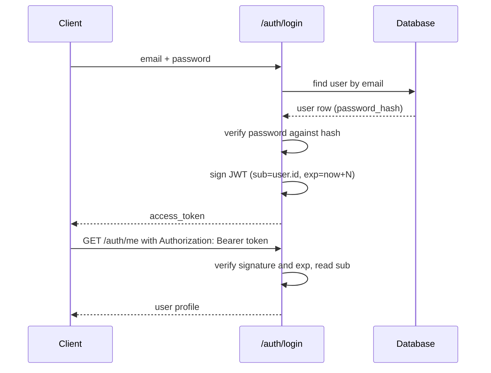

# LEARN: Pydantic schemas, password hashing, and JWT (A4)

Read this offline. Write the code yourself. Hints are at the end of Part 4 only if you're stuck.

---

## Part 1: Pydantic models (BaseModel)

### THEORY
A `BaseModel` is a class that describes the shape of data crossing your API boundary. There are two kinds you'll write:

- **Input schemas:** what the client sends (signup body, login body).
- **Output schemas:** what the client receives (user profile, token response).

Your model `User` is the database table. The schema is the API contract. Keeping them separate means the database can change without breaking clients, and sensitive columns never reach the response.

### WHY
You already return a dict from `GET /users/{user_id}`. That works, but nothing enforces the shape. A `BaseModel` makes three things automatic:

- **Validation:** a bad body is rejected with 422 before your route runs.
- **Filtering:** `response_model=` strips any field not declared in the output schema.
- **Docs:** Swagger at `/docs` shows the exact request and response shape.

### HOW IT WORKS
- Fields are declared with type hints, like the models you already wrote.
- `model_config = ConfigDict(from_attributes=True)` lets the schema read attributes from an ORM object (`user.email`) instead of requiring a dict.
- In the route decorator, `response_model=UserRead` tells FastAPI which schema to serialize with.

### SMALL EXAMPLE (not your project)

```python
from pydantic import BaseModel, ConfigDict

class ItemIn(BaseModel):
    name: str
    price: float

class ItemOut(BaseModel):
    model_config = ConfigDict(from_attributes=True)
    id: int
    name: str

@app.post("/items", response_model=ItemOut)
async def create_item(item: ItemIn):
    ...
```

`item: ItemIn` makes FastAPI parse and validate the request body. `response_model=ItemOut` means any extra fields on the returned object are dropped.

### YOUR PROJECT
`app/main.py`, the `/users/{user_id}` route returns a dict. Find the three keys it builds. Those are the fields a `UserRead` schema would declare.

---

## Part 2: Passwords are never stored or compared in plain text

### THEORY
A password hash is a one-way transformation with a random salt built in. You store the hash. To log in, you hash the attempt with the stored salt and compare the results. You never decrypt anything.

### WHY
If the database leaks, plain passwords leak with it, and users reuse passwords across sites. A hash limits the damage. Use a slow, purpose-built algorithm like bcrypt or argon2, not SHA-256.

### HOW IT WORKS
Your `requirements.txt` includes `passlib[bcrypt]`. Be aware that passlib is largely unmaintained and has known incompatibilities with recent `bcrypt` releases. If you see errors like `module 'bcrypt' has no attribute '__about__'`, the fix is to pin `bcrypt` to a version passlib supports, or to use `bcrypt` directly. Tell me which one you choose; both work.

Two functions do the job: one to hash a plain password on signup, one to verify it on login.

### YOUR PROJECT
Your `User.password_hash` column is `String(255)`. That's enough for a bcrypt hash, so no schema change is needed.

---

## Part 3: JWT (JSON Web Token)

### THEORY
A JWT is a signed string with three parts separated by dots: `header.payload.signature`.

- **Header:** the algorithm used to sign, like `HS256`.
- **Payload:** claims, which are data about the user. Common claims are `sub` (subject, the user id) and `exp` (expiry time, as a Unix timestamp).
- **Signature:** a hash of the header and payload using your `SECRET_KEY`.

The server signs the token at login. On every later request, the server recomputes the signature from the header and payload. If it matches, the token is genuine and unchanged.

### WHY
The server doesn't need to store sessions. The token carries its own proof. That's what makes an API stateless, and it's why `SECRET_KEY` must stay private.

### IMPORTANT: a JWT is signed, not encrypted
Anyone can read the payload. Anyone who has the token can decode it. Never put passwords, emails you want hidden, or anything secret in the payload. Put the user id only.

### HOW IT WORKS


- `settings.SECRET_KEY` is a `SecretStr`. Get the real value with `.get_secret_value()`. It's already defined in `app/core/config.py` and read from `.env`.
- Expiry belongs in config too. Add `ACCESS_TOKEN_EXPIRE_MINUTES` to `Settings` so it isn't hardcoded.
- A token that's expired or has a bad signature raises an error when decoded. Your code must catch that and return 401.

### YOUR PROJECT
`requirements.txt` includes `python-jose[cryptography]`, so use `jose.jwt` for encode and decode.

---

## Part 4: Your exercise (do this yourself)

### THE TASK
Build three things, each in the file named:

1. **Schemas** in `app/schemas/user.py` (the folder already exists with an empty `__init__.py`):
   - `UserCreate`: `email` and `password` (validate email format, since you have `pydantic[email]`-style validation available through `EmailStr` if you install `email-validator`).
   - `UserRead`: `id`, `email`, `created_at`. Use `from_attributes=True`.
   - `Token`: `access_token` and `token_type`.
2. **Signup** in `app/routers/auth.py`: `POST /auth/signup`. Hash the password, insert a `User`, return `UserRead` with `response_model=`. Return 409 if the email already exists. Remember the database has a case-insensitive unique index on the email, so catch the `IntegrityError` rather than checking first.
3. **Login** and **me**: `POST /auth/login` returns a `Token`. `GET /auth/me` requires a valid token and returns `UserRead` for the user in the token.

Then include the router in `app/main.py` with `app.include_router(...)`.

### HINTS (use only what you need)
- **Hint 1:** the structure matches `get_db`: a dependency function that reads the token, decodes it, and loads the user. Then `/auth/me` depends on it.
- **Hint 2:** for the header, FastAPI has `HTTPBearer` or `OAuth2PasswordBearer` in `fastapi.security`. Either reads `Authorization: Bearer ...`.
- **Hint 3:** for login, look up the user with `select(User).where(...)` on a lowercased email, because your unique index is on `lower(email)`. Use the same lowercasing on signup.

### WHAT TO SEND BACK
- The schema file and router file.
- The new `app/main.py` include line.
- `curl` output for: signup, login (showing the token), `/auth/me` with the token, and `/auth/me` with a bad token (should be 401).
- One sentence, in your own words: why does the token not need to be stored on the server?

Visit `http://127.0.0.1:8000/docs` to test each route with the Authorize button. This also checks that your `BaseModel` shapes show up correctly in Swagger.
