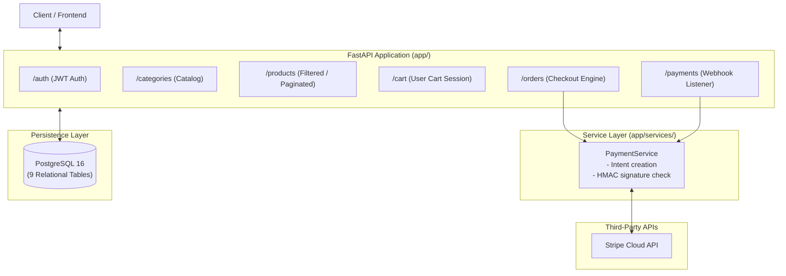

# Commerce API Documentation

An asynchronous e-commerce backend built with **FastAPI**, **PostgreSQL 16**, **SQLAlchemy 2.0 (asyncpg)**, and **Stripe**. Engineered for strict ACID guarantees under high concurrency, zero-trust webhook payment processing, and scalable catalog querying.

---

## 1. System Overview

---

## 2. Architecture & Design Patterns

### A. Separation of Concerns (4-Tier Architecture)
1. **Presentation Layer (`app/routers/`)**: Handles HTTP status codes, query/path parameters, dependency injection, and Pydantic serialization.
2. **Business / Service Layer (`app/services/`)**: Encapsulates external SDK interactions (Stripe), business calculations, and webhook validation.
3. **Data Access / Persistence (`app/models/`, `app/db/`)**: SQLAlchemy 2.0 declarative models, asynchronous session factory (`AsyncSession`), and connection pooling.
4. **Validation Layer (`app/schemas/`)**: Pydantic v2 schemas defining input validation rules and output response whitelisting (`from_attributes=True`).

### B. Concurrency & Inventory Protection (`POST /orders/checkout`)
To prevent overselling when multiple shoppers purchase the last available stock simultaneously:
- **Pessimistic Row-Level Locking**: Product rows are queried with `select(Product).with_for_update()`.
- **Deterministic Lock Ordering**: Product IDs are sorted numerically (`Product.id.asc()`) before lock acquisition to make database deadlocks mathematically impossible.
- **Atomic State Transitions**: Stock deduction, `Order` creation, frozen snapshotting in `OrderItem`, and `Cart.status = 'converted'` occur inside a single atomic transaction.

### C. Zero-Trust Payment Processing (`app/services/payment.py`)
- **Stripe PaymentIntent**: Raw credit card details never touch the server (PCI-DSS compliance). The server generates a `client_secret` for frontend Stripe Elements.
- **Integer Cents Representation**: Currency amounts are converted from `Decimal` to integer cents (`int((order.total * 100).to_integral_value())`) to eliminate binary float rounding errors.
- **HMAC-SHA256 Signature Verification**: Webhooks verify the `Stripe-Signature` header against the raw request bytes (`await request.body()`).
- **Idempotency**: Webhook events check existing order/payment states to safely ignore duplicate events without erroring.

---

## 3. API Endpoints Reference

| Method | Endpoint | Auth | Description |
|---|---|---|---|
| `POST` | `/auth/signup` | Public | Register new user with direct `bcrypt` password hashing (409 on duplicate email) |
| `POST` | `/auth/login` | Public | Authenticate user, mitigate timing attacks with dummy hash, return PyJWT |
| `GET` | `/auth/me` | Bearer JWT | Retrieve authenticated user profile |
| `GET` | `/categories` | Public | List all categories sorted by name |
| `POST` | `/categories` | Bearer JWT | Create category (unique name constraint) |
| `GET` | `/products` | Public | List active products with envelope pagination (`total`, `limit`, `offset`), case-insensitive search (`q`), price bounds (`min_price`, `max_price`), category filter, and safe sorting whitelist (`price_asc`, `price_desc`, `newest`) |
| `POST` | `/products` | Bearer JWT | Create product with category validation and unique SKU |
| `GET` | `/products/{id}` | Public | Retrieve single product details with eager-loaded category (`selectinload`) |
| `GET` | `/cart` | Bearer JWT | Retrieve or auto-create active user cart with live subtotal and total computations |
| `POST` | `/cart/items` | Bearer JWT | Add product to cart or increment quantity with stock availability checks |
| `PATCH` | `/cart/items/{id}` | Bearer JWT | Update cart item quantity scoped to user's active cart |
| `DELETE` | `/cart/items/{id}` | Bearer JWT | Remove item from cart (204 No Content) |
| `POST` | `/orders/checkout` | Bearer JWT | Execute ACID checkout with pessimistic row locks, stock deduction, and Stripe PaymentIntent creation |
| `POST` | `/payments/webhook` | Stripe Sig | Webhook listener verifying HMAC signature, confirming orders and payments |
| `GET` | `/health` | Public | Basic application health check |
| `GET` | `/health/db` | Public | Database connectivity check (`SELECT 1`) |

---

## 4. Database Schema

The database consists of 9 relational tables managed via Alembic migrations:
- **`users`**: User credentials with case-insensitive unique index (`lower(email)`).
- **`categories`**: Product classifications with unique name check constraint.
- **`products`**: Inventory items with decimal price (`Numeric(12, 2)`), stock check constraint (`stock >= 0`), and active flags.
- **`carts`**: Shopping cart sessions with partial unique index (`uq_carts_one_active_per_user` where `status = 'active'`).
- **`cart_items`**: Transient line items linked to active cart.
- **`orders`**: Permanent order contracts with total amount and shipping address JSONB.
- **`order_items`**: Frozen historical price and product snapshots (`unit_price`, `sku`, `product_name`).
- **`payments`**: Payment records tracking Stripe provider intent IDs and statuses.

Detailed SQL schema reference: [docs/architecture/schema.sql](schema.sql).
Visual ERD diagram: [docs/architecture/Schema.jpg](Schema.jpg).
