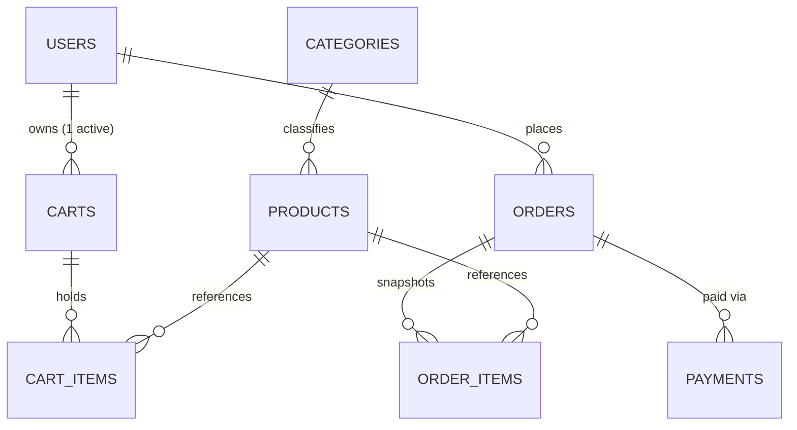

---
tags:
  - notes
  - postgresql
  - database
  - schema
---

# 🗄️ Notes: Phase A2 — Relational Schema Design & Constraints

> [!abstract] Overview
> Designing an enterprise e-commerce relational schema in PostgreSQL 16 with strong storage-level check constraints, functional indexes, and partial uniqueness.

---

## 🏛️ Core Relational Model (9 Tables)



---

## 💎 Specialized Storage-Level Constraints

### 1. Functional Case-Insensitive Email Index
```sql
CREATE UNIQUE INDEX uq_users_email_lower ON users (lower(email));
```
- **Why**: Prevents duplicate accounts with different capitalization (`user@example.com` vs `USER@EXAMPLE.COM`).
- **Code Pattern**: Always query with `func.lower(User.email) == email.lower()`.

### 2. Partial Unique Index on Active Carts
```sql
CREATE UNIQUE INDEX uq_carts_one_active_per_user 
ON carts (user_id) 
WHERE status = 'active';
```
- **Why**: Guarantees a customer has at most **1 active cart** at any given moment.
- Converted or abandoned carts don't block creating fresh carts later.

### 3. Invariant Storage Checks (`CheckConstraint`)
Never rely solely on application-layer validation. Enforce constraints directly in PostgreSQL:
```sql
CHECK (stock >= 0)
CHECK (price >= 0)
CHECK (quantity > 0)
CHECK (LENGTH(TRIM(name)) > 0)
```

---

## ⚡ Foreign Key Cascade Rules

| Relationship | On Delete Rule | Rationale |
| :--- | :---: | :--- |
| `carts -> cart_items` | `CASCADE` | Deleting a transient cart safely wipes its line items. |
| `orders -> order_items` | `RESTRICT` | Critical accounting records must never be accidentally deleted. |
| `products -> order_items` | `SET NULL` | Deleting a catalog product preserves past customer receipts and invoices. |

---

## 🔗 Related Notes & Deep Dives
- ⬅️ Previous: [[notes/A1_foundations|A1: Foundations]]
- ➡️ Next Milestone: [[notes/A3_sqlalchemy_alembic|A3: SQLAlchemy & Alembic]]
- 📜 Schema File: [[architecture/schema.sql|Raw SQL Schema]]
