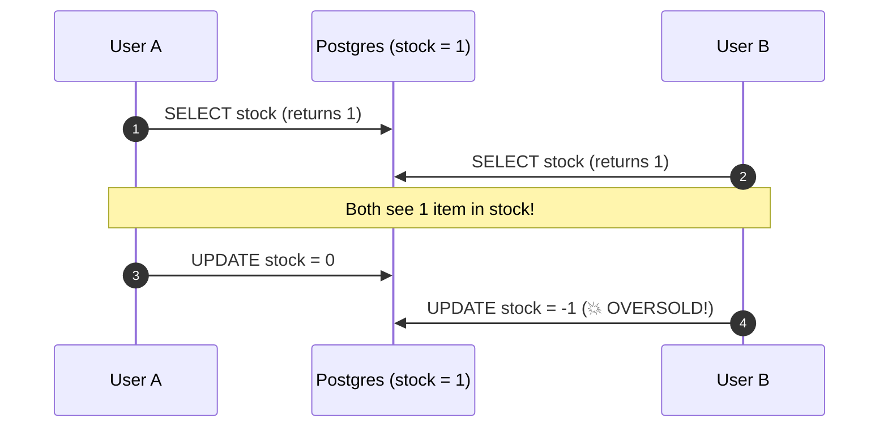

---
tags:
  - notes
  - concurrency
  - checkout
  - locking
---

# 🔒 Notes: Phase A6 — Cart Mechanics & Pessimistic Concurrency

> [!abstract] Overview
> Building an active shopping cart session manager and solving inventory race conditions (overselling) during checkout using PostgreSQL row-level locks (`SELECT ... FOR UPDATE`).

---

## ⚡ The Concurrency Overselling Problem



---

## 🛡️ The Solution: Pessimistic Locking (`with_for_update`)

```python
stmt = (
    select(Product)
    .where(Product.id.in_(product_ids))
    .order_by(Product.id.asc())  # Prevents Deadlocks!
    .with_for_update()
)
```

### The 3 Core Guarantees:
1. **Exclusive Lock**: PostgreSQL places an in-memory lock on the selected product rows. Concurrent checkouts on the same items are forced to pause and wait.
2. **Deadlock Elimination**: By sorting `product_ids` in ascending numerical order, all concurrent transactions acquire row locks in the exact same sequence. Circular lock dependency is impossible.
3. **Rollback Release**: If a stock check fails, calling `await db.rollback()` immediately releases the row locks and restores inventory.
4. **Lock Decoupling**: Database transactions with pessimistic locks are committed immediately ($\sim$2–5 ms) *before* external network calls (Stripe) are made. If payment creation fails, inventory is restored using atomic SQL updates.

---

## 📜 Price Snapshotting (`OrderItem`)
Store prices fluctuate over time. Customer invoices must remain immutable:
```python
OrderItem(
    product_id=product.id,
    product_name=product.name,  # Frozen snapshot
    sku=product.sku,            # Frozen snapshot
    unit_price=product.price,   # Frozen snapshot
    quantity=cart_item.quantity
)
```

---

## 🔗 Related Notes & Deep Dives
- ⬅️ Previous: [[notes/A5_catalog_queries|A5: Catalog & Filters]]
- ➡️ Next Milestone: [[notes/A7_stripe_payments|A7: Stripe Payments]]
- ⚡ [[learning/SKILL|Master SKILL Reference]]
