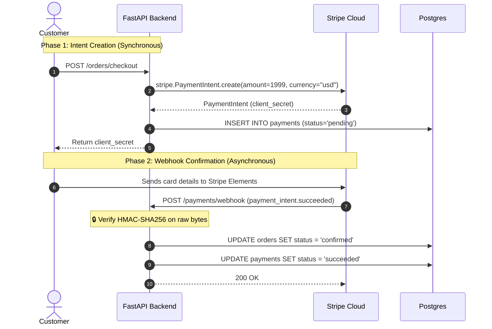

---
tags:
  - notes
  - stripe
  - payments
  - webhooks
---

# 💳 Notes: Phase A7 — Stripe Payments & Zero-Trust Webhooks

> [!abstract] Overview
> Implementing the Stripe PaymentIntent lifecycle, integer cents precision, `db.flush()` entity allocation, and HMAC-SHA256 signature verification for webhooks.

---

## 🔄 Two-Phase Payment Flow



---

## 💎 Critical Implementation Details

### 1. Integer Cents Conversion
Never pass floating-point dollars to Stripe:
```python
amount_cents = int((order.total * 100).to_integral_value())
```

### 2. The `await db.flush()` Pattern
When inserting an entity with a database-generated ID (`Identity(always=True)`):
- `db.add(order)` leaves `order.id` as `None`.
- `await db.flush()` sends SQL to Postgres to allocate `order.id` **without committing or ending the transaction**.
- Now `order.id` can be linked to Stripe metadata and the `Payment` table before the final commit.

### 3. Raw Bytes for Webhook HMAC
Stripe hashes the exact raw body sent over the network. If FastAPI parses JSON first, key order and whitespace change, breaking the signature.
```python
payload = await request.body() # Raw bytes!
event = stripe.Webhook.construct_event(
    payload=payload,
    sig_header=stripe_signature,
    secret=settings.STRIPE_WEBHOOK_SECRET.get_secret_value()
)
```

---

## 🔗 Related Notes & Deep Dives
- ⬅️ Previous: [[notes/A6_concurrency_checkout|A6: Concurrency & Checkout]]
- ⚡ [[learning/SKILL|Master SKILL Reference]]
- 🗺️ [[roadmap|Roadmap Overview]]
