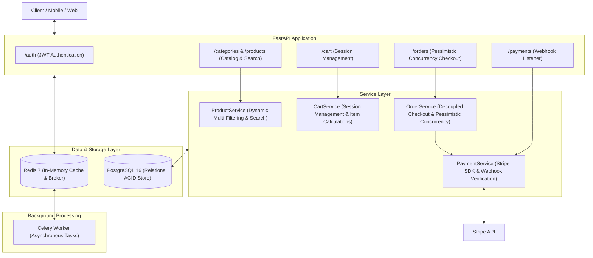

# Commerce API — Project Roadmap & Technical Specification

An engineering specification and architectural roadmap for a production-grade, asynchronous e-commerce backend built with **FastAPI**, **PostgreSQL**, **SQLAlchemy 2.0 (asyncpg)**, **Stripe**, **Redis**, and **Celery**.

---

## Architecture Overview

---

## Milestone Breakdown (Phases A1 – A9)

### Phase A1: Project Foundations & Async Runtime
- **Repository Structure**: Layered architecture separating presentation (`routers`), business logic (`services`), data models (`models`), data transfer objects (`schemas`), and persistence (`db`).
- **Configuration Management**: Type-safe settings parsed from environment files via `pydantic-settings` with secret masking (`SecretStr`).
- **Database Session Lifecycle**: Asynchronous engine setup (`create_async_engine`) using `asyncpg` with `expire_on_commit=False` and a scoped dependency injection generator (`get_db`).
- **Health Verification**: Basic application ping (`/health`) and database connectivity probes (`/health/db`).

### Phase A2: Relational Database Schema Design
- **Entities & Relationships**: Relational model comprising 9 tables: `users`, `categories`, `products`, `carts`, `cart_items`, `orders`, `order_items`, `payments`.
- **Integrity Constraints**:
  - `CheckConstraint` on positive stock, non-negative prices, and non-empty category names.
  - Foreign key cascades (`CASCADE` for carts/cart items; `RESTRICT` for critical accounting records like orders and payments).
- **Index Optimization**:
  - Functional case-insensitive index on user emails (`lower(email)`).
  - Partial unique index on active shopping carts (`uq_carts_one_active_per_user` where `status = 'active'`).
  - Compound indexes on sorting keys and foreign keys.

### Phase A3: Database Layer & Migration Lifecycle (Alembic)
- **SQLAlchemy 2.0 Declarative Models**: Mapped column typing using `Mapped[...]` and `mapped_column()`.
- **Schema Migrations**: Migration chain tracked via Alembic revisions.
- **Rollback Verification**: Tested forward upgrades and backward rollbacks to ensure idempotent schema application across environments.

### Phase A4: Stateless Authentication & Security (JWT)
- **Cryptographic Password Hashing**: Direct `bcrypt` hashing with salt generation (avoiding unmaintained abstraction layers).
- **Timing Attack Mitigation**: Execution of constant-time comparisons using dummy hashes on nonexistent user logins.
- **Stateless Session Management**: Cryptographic signing of JWT tokens using HMAC-SHA256 (`PyJWT`) with standard claims (`sub`, `exp`).
- **Route Authorization**: Dependency-injected Bearer token verification (`HTTPBearer`) with automated 401 handling.

### Phase A5: Product & Category Catalog
- **Category Hierarchy**: Category creation with unique constraint conflict resolution (409 Conflict) and alphabetical listing.
- **Dynamic Multi-Filtering**:
  - Search query (`q`) with case-insensitive substring matching (`ILIKE`) and wildcard auto-escaping.
  - Price boundary filtering (`min_price`, `max_price`).
  - Category filtering and active product gating (`is_active = True`).
- **Safe Sorting Whitelist**: Mapping allowed user sort keys (`price_asc`, `price_desc`, `newest`) with deterministic secondary tiebreakers (`id.asc()`) to prevent pagination drift.
- **Pagination Envelope**: Structured response containing `items`, `total` (from an isolated count query sharing the same conditions), `limit`, and `offset`.
- **Eager Loading Optimization**: Elimination of async lazy-load errors (`MissingGreenlet`) using `selectinload` on product categories.

### Phase A6: Shopping Cart & Concurrency-Safe Checkout
- **Cart Session Mechanics**: Auto-creating active cart sessions per user with subtotal and total calculations computed dynamically from related product snapshots.
- **Multi-Tenancy Protection**: Scoping all cart item mutations and deletions strictly to `cart_id == cart.id` to prevent cross-account tampering.
- **Pessimistic Concurrency (Row-Level Locking)**:
  - Exclusive row locking using `SELECT ... FOR UPDATE` via `.with_for_update()`.
  - Deterministic lock ordering (sorting product IDs in ascending numerical order) to eliminate PostgreSQL deadlocks.
  - Atomic stock verification and inventory deduction.
- **Immutable Price Snapshots**: Freezing `unit_price`, `sku`, and `product_name` in `order_items` at checkout time to guarantee legal receipts never mutate when future catalog prices change.
- **Cart Lifecycle Conversion**: Transitioning `cart.status = 'converted'` within the same database transaction, freeing up the partial index for subsequent visits.

### Phase A7: External Payment Integration (Stripe)
- **Zero-Trust Payment Flow**: Utilization of Stripe `PaymentIntent` where client card data is submitted directly to Stripe Elements, eliminating PCI-DSS compliance exposure on the application server.
- **Precision Currency Handling**: Conversion of `Decimal` currency to integer cents (`to_integral_value()`) to prevent floating-point binary representation errors.
- **Database Entity Flushing**: Explicit `await db.flush()` execution within active transactions to allocate auto-generated PostgreSQL IDs before communicating with external APIs.
- **Cryptographic Webhook Verification**: HMAC-SHA256 signature verification over raw request bytes (`await request.body()`) against `STRIPE_WEBHOOK_SECRET`.
- **Webhook Idempotency**: State-checking logic preventing duplicate webhook events from double-updating orders or triggering unnecessary retry storms.

### Phase A8: Performance Caching & Asynchronous Task Processing
- **In-Memory Caching (Redis)**:
  - Caching hot, read-heavy catalog queries (`/categories`, `/products`) with configurable TTL (Time-To-Live).
  - Explicit cache invalidation triggered on product creation, updates, or catalog mutations.
- **Background Worker Queues (Celery)**:
  - Offloading slow operations (e.g., generating PDF invoices, sending order confirmation emails) out of the HTTP request-response cycle.
  - Decoupling task scheduling using Redis as the message broker.

### Phase A9: Production Readiness, Containerization & CI/CD
- **Containerization (Docker & Compose)**: Multi-container orchestration linking the FastAPI app, PostgreSQL, Redis, and Celery worker into an isolated network.
- **Automated Testing Suite (`pytest-asyncio`)**:
  - Isolated test fixtures with transactional database rollbacks.
  - High-concurrency race condition tests proving row-level locks prevent overselling.
  - Authentication, catalog filtering, and webhook signature verification suites.
- **Continuous Integration (GitHub Actions)**: Automated pipeline executing code linting, static type analysis, and test suites on every pull request.
